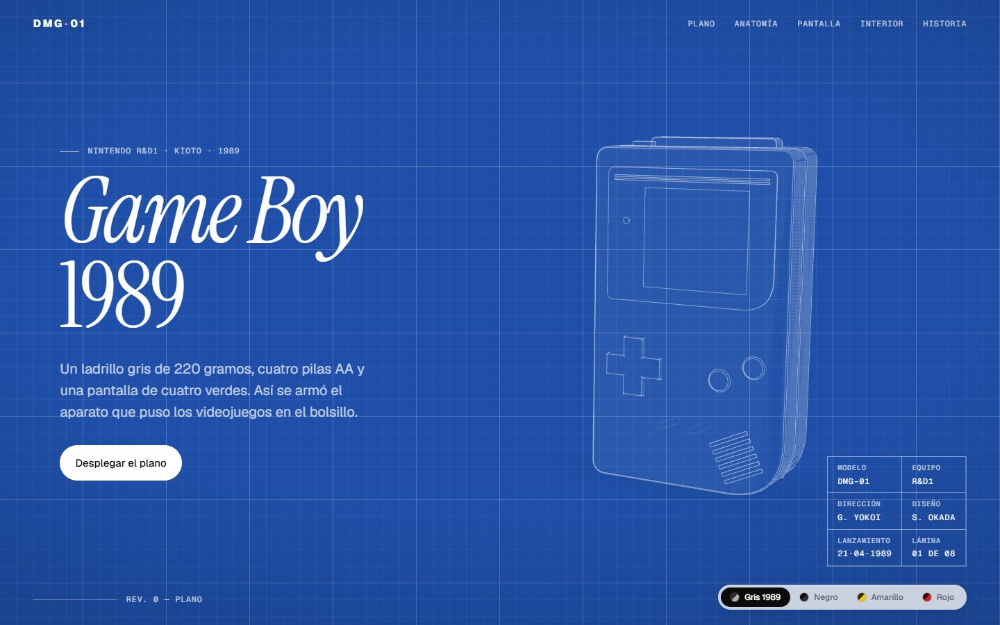
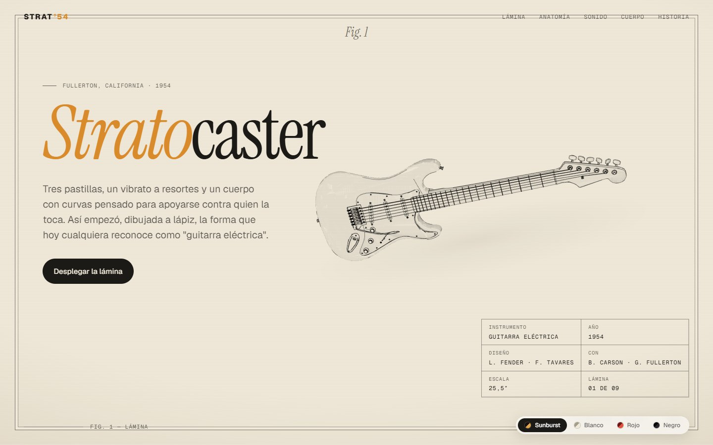
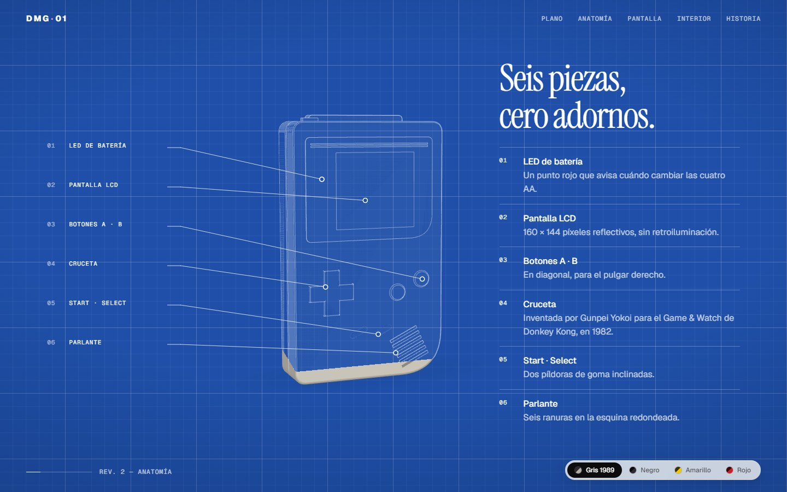
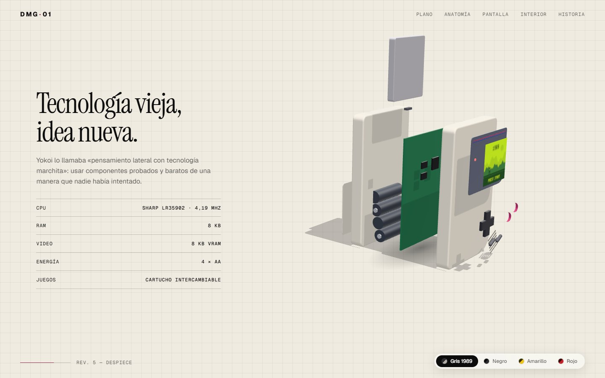
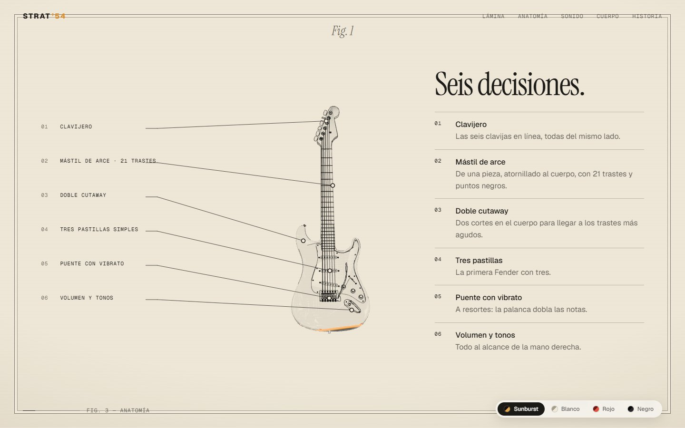
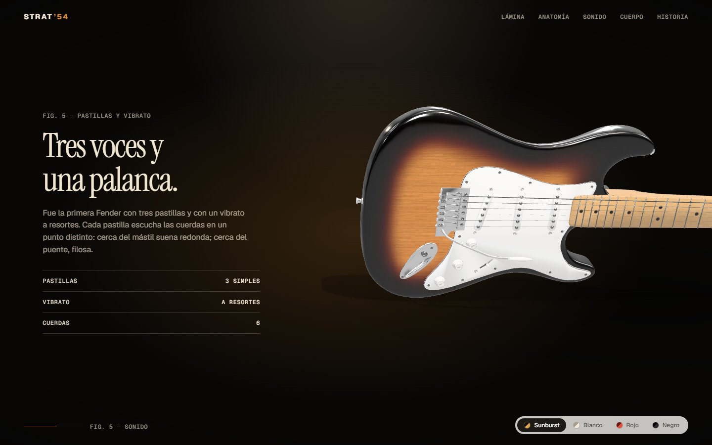

# scroll-3d-landing

**Una skill de Claude para crear landing pages con un objeto 3D protagonista**: el objeto se arma, se revela, cambia de color y se despieza mientras scrolleás. Sirve para cualquier cosa (una consola, una guitarra, una botella, un mueble, una pieza de museo) y está hecha en HTML, CSS y JavaScript sin framework, más [Three.js](https://threejs.org).

**Demos en vivo → [nachoiannella.github.io/scroll-3d-landing](https://nachoiannella.github.io/scroll-3d-landing/)**

| [Game Boy, 1989](https://nachoiannella.github.io/scroll-3d-landing/demos/gameboy/) | [Stratocaster, 1954](https://nachoiannella.github.io/scroll-3d-landing/demos/stratocaster/) |
|---|---|
| [](https://nachoiannella.github.io/scroll-3d-landing/demos/gameboy/) | [](https://nachoiannella.github.io/scroll-3d-landing/demos/stratocaster/) |
| Modelo **armado por código**, pieza por pieza y en milímetros reales. Plano técnico azul → manual de 1989. Despiece, pantalla LCD que se enciende y carcasas "Play It Loud!". | Modelo **descargado** de Sketchfab (CC BY) y optimizado de 22 MB a 1,8 MB. Lámina de patente → escenario. Acabados que pintan solo el cuerpo y una guitarra que se para para mostrar su anatomía. |

---

## Qué hace la skill

Cuando le pedís a Claude algo como *"haceme una landing de mi producto con el 3D que se arma al scrollear"*, la skill lo guía por todo el proceso:

1. **Concepto y guion.** Elige una metáfora visual para el objeto (plano técnico, lámina de patente, ficha de museo, laboratorio…) y arma la historia en 5–9 actos.
2. **Conseguir el modelo 3D.** Escanearlo con el celular (fotogrametría), generarlo con IA a partir de fotos, modelarlo en Blender, convertirlo desde CAD, descargarlo con licencia libre o construirlo por código.
3. **Optimizarlo** para la web con un script incluido (gltf-transform + Meshopt + texturas WebP).
4. **Armar la página** desde una plantilla que ya trae resuelta la ingeniería: render de estudio, shaders de revelado, coreografía por scroll, cotas y callouts SVG, variantes de color.
5. **Ajustar y verificar** en el navegador: capturas por sección, escritorio y móvil.

### Por qué se ve bien

No es por el stack: es por cinco cosas que la skill trabaja una por una.

| | |
|---|---|
| **Un buen modelo** | Escaneado, bajado o modelado; limpio, liviano y a escala real. Las cotas que muestra la página salen del modelo. |
| **Render de estudio** | Tres luces, environment, tone mapping neutro, sombra de contacto y materiales corregidos. |
| **Un concepto llevado al detalle** | El loader, el rail de progreso, la tipografía y los textos cuentan la misma historia. |
| **Movimiento con peso** | Cada sección declara una pose; el motor interpola con *smoothstep* y amortigua exponencialmente. |
| **Efectos que justifican el 3D** | Plano que se vuelve material (con líneas ocultas reales), despiece, recoloreo por shader, pantallas que se encienden. |

|  |  |
|---|---|
|  |  |

---

## Instalación

### Claude Code

```bash
git clone https://github.com/nachoiannella/scroll-3d-landing.git
cp -r scroll-3d-landing/scroll-3d-landing ~/.claude/skills/
```

Si la querés solo para un proyecto, copiala en `.claude/skills/` dentro de ese proyecto. Claude la usa sola cuando el pedido encaja; no hace falta nombrarla.

### claude.ai / app de Claude

Descargá [`scroll-3d-landing.skill`](scroll-3d-landing.skill) y subilo en la sección **Skills** de la configuración.

---

## Cómo usarla

Pedile a Claude lo que quieras mostrar, con el contexto que tengas. Por ejemplo:

> Quiero una landing para la historia de la cámara Polaroid SX-70, con el 3D que se despliega al scrollear. No tengo modelo.

> Escaneé una zapatilla con el celular (está en `scan.glb`). Armame una landing tipo plano técnico con sus medidas y partes.

> Buscame un modelo libre de una guitarra eléctrica y hacé una página sobre su historia.

> Tengo el STEP de nuestro parlante. Hacé una página de producto con vista explosionada y los tres colores.

Claude va a preguntarte lo mínimo (el objeto, los datos reales, el concepto), conseguir u optimizar el modelo, armar la página y revisarla en el navegador.

### Usar la plantilla sin Claude

La carpeta [`scroll-3d-landing/assets/template/`](scroll-3d-landing/assets/template/) es una página que funciona sola:

```bash
cd scroll-3d-landing/assets/template
python -m http.server 8000      # o: npx serve
```

- Poné tu modelo en `models/product.glb` (o abrí `?model=<url de un .glb>`).
- Ajustá el bloque `CONFIG` al principio de `main.js`: orientación, tamaño real, callouts y colores.
- Cada `<section>` del `index.html` declara la pose del objeto con atributos: `data-ry`, `data-x`, `data-scale`, `data-reveal`, `data-explode`, `data-rz`…

Parámetros útiles en la URL: `?debug` (ejes, clic para obtener coordenadas, `__settle()` y `__dbg()` en la consola), `?wire` (solo el plano), `?wiremode=edges`, `?shot=<id de sección>` (abre la página ya asentada en esa sección, ideal para capturas).

---

## Qué incluye

```
scroll-3d-landing/              ← la skill
├── SKILL.md                    flujo completo en 7 fases + cómo adaptar a cada tipo de objeto
├── references/
│   ├── 3d-capture.md           escanear con fotogrametría: luz, tomas, apps, limpieza en Blender
│   ├── 3d-alternatives.md      sin escaneo: IA image-to-3D, Blender, CAD, compra, procedural
│   ├── asset-pipeline.md       optimización, malla de wire, cuantización, presupuestos
│   ├── rendering.md            luces, tone mapping, sombras, materiales
│   ├── shaders.md              revelado, líneas ocultas, recoloreo, llenado, corte, despiece, puntos
│   ├── choreography.md         sistema de poses, objetos largos, drag, móvil
│   ├── art-direction.md        conceptos visuales, tipografía, color, checklist de pulido
│   └── performance.md          carga, accesibilidad y QA
├── scripts/prepare-model.sh    optimiza un .glb/.obj y genera la malla de wire
└── assets/
    ├── template/               plantilla lista para usar
    └── examples/               Game Boy (procedural) y Stratocaster (modelo descargado)
demos/                          las dos demos publicadas en GitHub Pages
img/                            capturas
```

---

## Créditos y licencias

- **Código** (skill, plantilla y demos): [MIT](LICENSE).
- **Modelo de la Stratocaster:** ["Fender Stratocaster Guitar"](https://sketchfab.com/3d-models/fender-stratocaster-guitar-15a37147641b4c1b963bb494b234593f) de Ryan_Nein, bajo licencia [CC BY 4.0](https://creativecommons.org/licenses/by/4.0/). Lo optimicé para la web.
- **Game Boy:** modelo, pixel art y etiquetas originales, armados por código. No se reproduce ningún logo.
- [Three.js](https://threejs.org) (MIT), fuentes [Geist](https://vercel.com/font) e [Instrument Serif](https://fonts.google.com/specimen/Instrument+Serif) (OFL).
- Inspirada en el nivel de calidad de [toppervenom.com](https://toppervenom.com).

Las demos son **proyectos de homenaje, no oficiales**. *Game Boy* es una marca registrada de Nintendo. *Fender* y *Stratocaster* son marcas registradas de Fender Musical Instruments Corporation. Ninguna de las dos empresas participa en este proyecto ni lo respalda.
